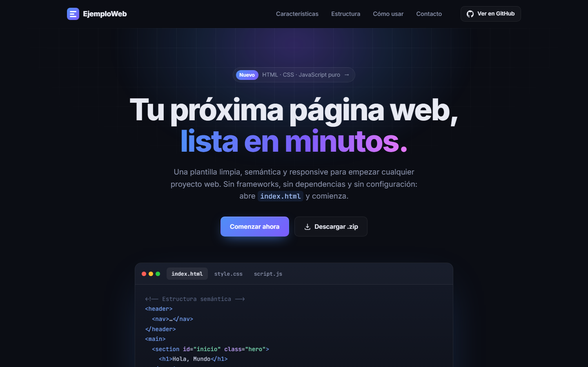

<div align="center">

# EjemploWeb — Plantilla web estática

Plantilla profesional con HTML, CSS y JavaScript puro. Sin frameworks ni dependencias externas.

<a href="https://ejemplo-pagina-n9tv.vercel.app">
  
</a>

<br /><br />



</div>

---

## Estructura de archivos

```
proyecto-ejemplo/
├── index.html   # Estructura y contenido de la página
├── style.css    # Estilos: variables, layout, componentes
├── script.js    # Lógica del cliente (eventos, DOM)
└── README.md    # Este archivo
```

---

## Cómo usar

1. Descarga o clona la carpeta.
2. Abre `index.html` directamente en el navegador — no requiere servidor.
3. Modifica los archivos según tu proyecto.

> Para desarrollo con recarga automática puedes usar la extensión **Live Server** de VS Code.

---

## Qué incluye

### `index.html`
- Estructura semántica: `<header>`, `<main>`, `<section>`, `<footer>`
- Navegación con anclas a secciones
- Sección hero con botón de llamada a la acción
- Grilla de tarjetas informativas
- Formulario de contacto con nombre, email y mensaje
- Enlace a `style.css` y `script.js`

### `style.css`
- Variables CSS (`--color-*`, `--radio`, `--sombra`, etc.)
- Reset básico con `box-sizing: border-box`
- Header sticky con efecto `backdrop-filter` al hacer scroll
- Bento grid, ventana de código con pestañas y tarjetas con foco de luz
- Breakpoints para tablet (960 px) y móvil (720 px) con menú hamburguesa
- Respeta `prefers-reduced-motion`

### `script.js`
- Módulo envuelto en `DOMContentLoaded`
- Función helper `$()` para `querySelector`
- Año dinámico en el footer
- Scroll suave al hacer clic en el botón del hero
- Menú móvil, pestañas de código y enlace activo según la sección visible
- Animaciones de aparición y contadores con `IntersectionObserver`
- Validación de nombre, email y mensaje con respuesta simulada (`setTimeout`)

---

## Personalización rápida

| Qué cambiar          | Dónde                          |
|----------------------|--------------------------------|
| Colores principales  | Variables `--color-*` en CSS   |
| Tipografía           | Variable `--fuente` en CSS     |
| Textos y secciones   | Directamente en `index.html`   |
| Lógica de eventos    | Funciones en `script.js`       |

---

## Requisitos

- Ninguno. Solo un navegador moderno (Chrome, Firefox, Edge, Safari).

---

## Licencia

Uso libre — sin restricciones.
